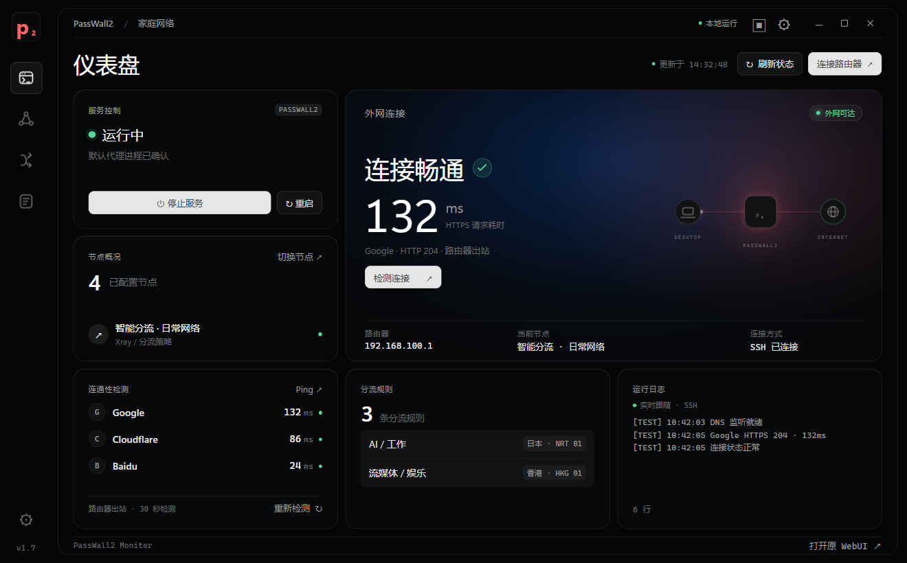
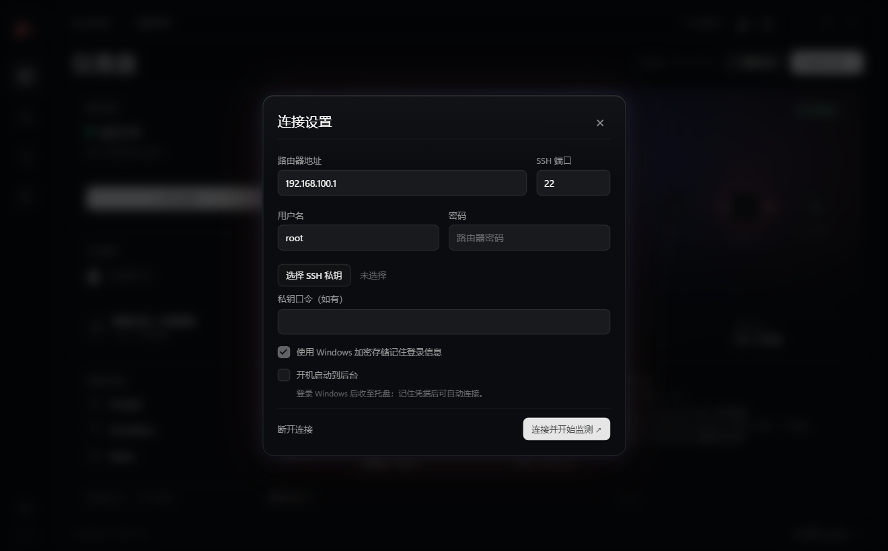
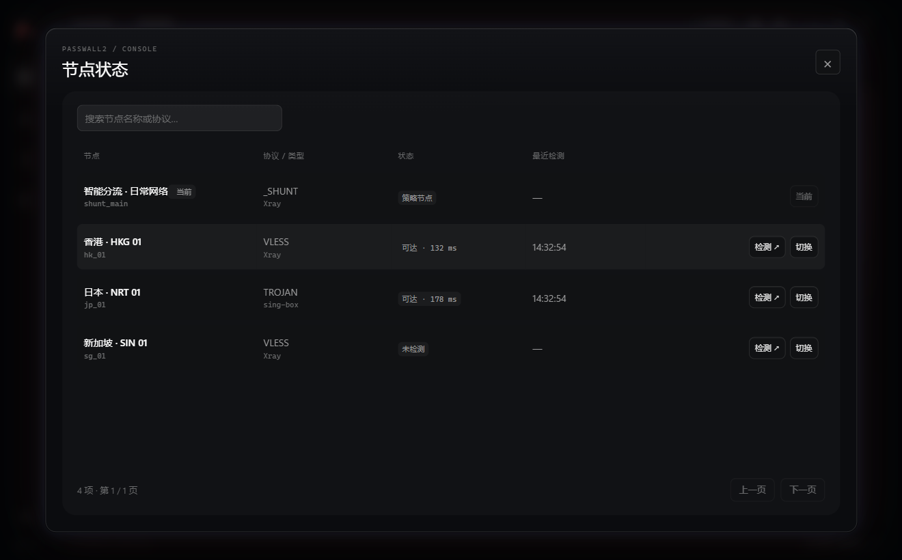

# PassWall2 Monitor · Windows 桌面面板

本地桌面程序，使用路由器现有 SSH 服务，无需修改路由器源码，也不会安装路由器插件。

## 界面预览

| 连接设置 | 节点状态 |
| --- | --- |
|  |  |

> 预览图使用测试数据生成。安装包请到 [Releases](../../releases/latest) 下载 `PassWall2-Monitor-1.7.0-Setup.exe`（Windows 10/11，x64）。

## v1.7 弹窗与 WebUI

1. 双击 `release/PassWall2-Monitor-1.7.0-Setup.exe`（Windows 10/11，x64），安装后使用桌面或开始菜单中的「PassWall2 Monitor」快捷方式。不需要安装 Node.js。
2. 打开「连接设置」，填写路由器地址、SSH 端口、用户名和密码，或选择 SSH 私钥。默认地址是 `192.168.100.1`，默认端口 `22`。
3. 首次连接时，核对 SSH 主机指纹后信任。可使用已有可信 SSH 会话中的主机密钥指纹核对。主机指纹变化时会再次提示。
4. 关闭主窗口会收至托盘。点击托盘图标打开完整界面，右键托盘可显示迷你状态条或退出。顶部的方块按钮也能显示迷你条；迷你条可拖动，点击 P 打开完整面板。
5. 窗口控制按钮融入顶部，空白处可拖动，最大化按钮可切换还原。演示模式已删除，未连接时显示离线。外网主模块动效跟随在线、检测中、服务切换与异常状态，遵循系统减少动态效果设置。

安装版数据保存在 `%APPDATA%\passwall2-desktop`，升级和卸载保留用户数据。旧便携版数据位于 EXE 同目录的 `PassWall2-Data` 文件夹。勾选「记住登录信息」才会保存凭据；使用 Electron safeStorage / Windows DPAPI 加密，绑定当前 Windows 用户。复制程序到其他电脑时需重新填写凭据。不勾选时只在进程内保留凭据。SSH 私钥支持常见 OpenSSH / PEM 格式；不支持 PuTTY `.ppk`，请先转换。

## 已实现

| 功能 | 实现与语义 |
|---|---|
| 启动 / 停止 / 重启 | 使用 `/etc/init.d/passwall2`；启动会设置 UCI `enabled=1`，停止为本次停止，保留配置开关，路由器重启可能再次启动。 |
| 服务状态 | 读取 `/proc` 的真实命令参数，兼容 iStoreOS 的 `acl/default.json` 与上游 `acl_default.json`，避免 ps 截断和 grep 误匹配。结合服务命令、实际持有的锁及日志周期，区分启动中、停止中、运行中、已停止与待确认；正常每 5 秒刷新，面板发起操作期间每 2 秒刷新，最多等待 180 秒。仅启用特殊 ACL 或 SOCKS 的配置不代表默认代理已运行。 |
| 外网连接 | 路由器端 curl HTTPS 探测 Google、Cloudflare、Baidu，每 30 秒检测，也可手动触发。仅 HTTP 2xx/3xx 记为可达，验证 TLS 证书。主模块显示 Google 请求总耗时，不是 ICMP 延迟或带宽。 |
| 节点状态 | 读取节点列表，逐个调用 PassWall2 自带 `test.sh url_test_node`。该上游测试会临时启动测试代理，并按上游脚本行为处理 TLS。未测试节点标为「未检测」；策略节点不作为真实出口测试。 |
| 分流查看 / 修改 | 查看现有 `shunt_rules`；编辑域名列表、IP 列表，并修改 `_shunt` 策略中该规则的目标节点。可选择仅保存或保存并重启。保留其他字段、规则顺序和节点机密字段。 |
| 冲突检测 / 备份 | 保存前重新读取并比较规则和目标映射，拒绝存在未提交 UCI 更改的情况。先备份旧规则到本机 `rule-backups`，再提交 UCI；备份失败不写配置。检查与写入之间仍有极短竞争窗口，编辑时请避免同时使用其他管理工具。 |
| 实时日志 | SSH `tail -F /tmp/log/passwall2.log` 实时跟随，前端仅显示文本，最多保留约 128 KiB。流不可用时降级为每 5 秒读取快照。支持暂停显示、关键词筛选与导出。 |
| 托盘与迷你条 | Windows 通知区域托盘图标；可选的右下角置顶迷你条，点开完整界面。 |

## 前提与限制

- 路由器须能通过局域网 SSH 访问，登录用户须有读取 UCI、执行服务命令和提交配置的权限（通常是 root）。此版本不依赖 LuCI 登录，也不支持仅有 WebUI 密码而无 SSH 访问的环境。
- 需要路由器已有 `lua`、`luci.model.uci`、`luci.jsonc`、`curl` 和 PassWall2。程序不会自动安装或修改这些组件。旧版本或第三方固件的路径和字段可能不同。
- 只修改用户提交的 PassWall2 **配置**，不修改 `/usr/share/passwall2`、LuCI 或任何路由器**源码**。查看、探测与日志功能不会提交配置；节点测试会按 PassWall2 自带脚本创建临时运行文件和进程。
- 外网状态反映路由器自身出站 HTTPS 请求的结果，依赖现有分流和 localhost 代理设置；不能证明所有 LAN 客户端、所有站点或所有规则都正常。节点测试和路由器出站测试分别展示。
- 未实现订阅管理、新增/删除/排序规则、负载均衡管理、完整 ACL/DNS 编辑和逐规则命中计数；高级功能请使用「打开原 WebUI」。修改 GeoSite/GeoIP 内容仍依赖路由器已有数据库。
- Windows 不允许普通应用向系统任务栏随意嵌入自定义控件，因此使用通知区托盘 + 独立迷你状态条，不是嵌入式任务栏插件。
- 每次启动只在已记住凭据且存在可信指纹时尝试自动连接一次；启动时网络尚未就绪或连接中断后，可手动重新连接。
- EXE 未做商业代码签名，Windows 可能显示未知发布者提示。

